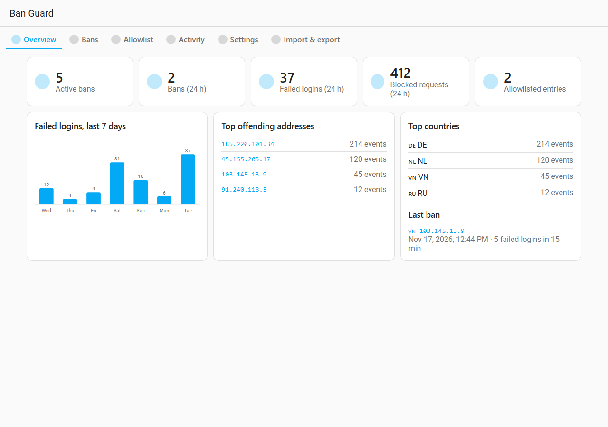
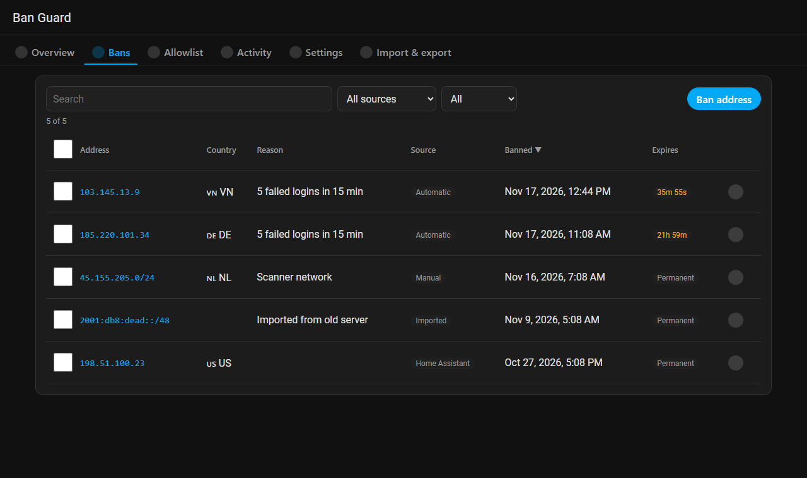
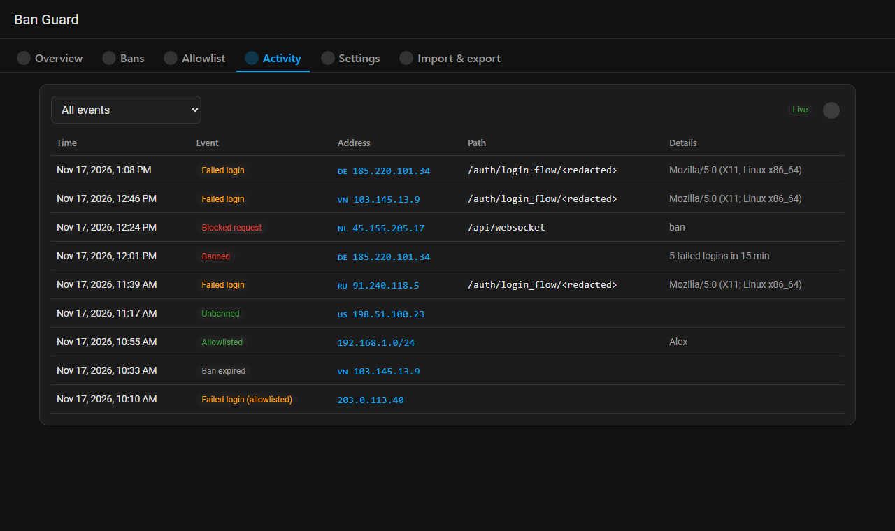
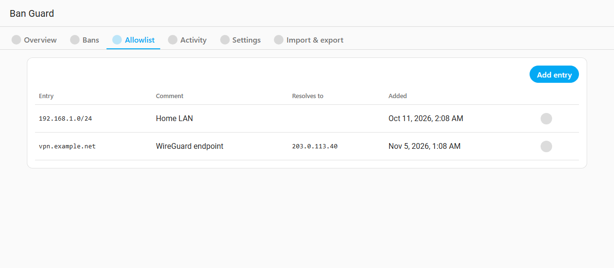
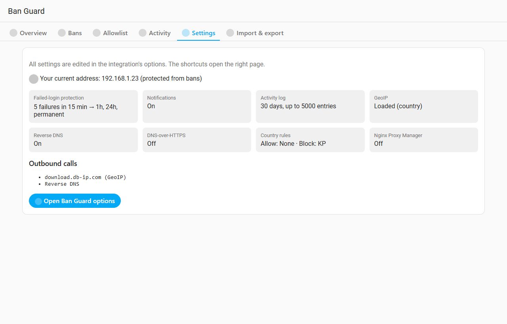

# Ban Guard for Home Assistant

See, ban, unban and allowlist the IP addresses that reach Home Assistant, and stop failed-login attacks, from an admin-only sidebar panel.

[](https://github.com/AzezSalami/ha-ban-guard/actions/workflows/ci.yml)
[](https://securityscorecards.dev/viewer/?uri=github.com/AzezSalami/ha-ban-guard)
[](https://hacs.xyz/docs/faq/custom_repositories)



| Bans (dark theme) | Activity (live) |
| --- | --- |
|  |  |
|  |  |

> The screenshots come from the development harness in `frontend/demo/` with sample data. Icons show as placeholders there; inside Home Assistant they are the normal MDI icons.

## Features

- **Ban list.** Single IPs and CIDR ranges, IPv4 and IPv6. Every ban records a reason, a source (manual, automatic, imported, action, Home Assistant), who created it, when, and an optional expiry. Expired bans are lifted automatically, and they stop blocking the moment they expire.
- **Stays in sync with Home Assistant.** Permanent single-address bans are written to HA's own `ip_bans.yaml`, and HA's in-memory ban list is updated at the same time. Temporary bans and ranges live in Ban Guard's storage, so removing Ban Guard never turns a temporary ban into a permanent one, and HA's loader never sees a format it can't read.
- **Allowlist** of IPs, CIDRs and hostnames. Hostnames are re-resolved periodically. Allowlisted addresses are never banned or blocked. Failed logins from them can still be reported.
- **Failed-login protection** with a configurable threshold and time window, escalating bans (default `1h, 24h, permanent`), and per-network overrides such as `192.168.0.0/16: 20/60` or `10.0.0.0/8: off`.
- **Lockout guard.** Loopback, this host's own addresses, the Supervisor network (`172.30.32.0/23`), trusted proxies, addresses an administrator used in the last day, and your current address can never be banned. Bans that would cover them are refused with a clear message.
- **Activity log** of failed logins, bans, unbans and blocked requests, with IP, path, user agent and time. It is bounded, stored in `.storage`, and purged by a retention setting. Query strings are never stored, and secret URL parts such as webhook ids and ingress tokens are redacted.
- **Optional enrichment** (each off by default): GeoIP from the free DB-IP Lite database, with country allow and deny rules; reverse DNS; DNS-over-HTTPS.
- **Notifications**: persistent notifications and a `ban_guard_event` event. A blueprint forwards them to the mobile app with **Unban** and **Allowlist** buttons.
- **Entities**: active bans, bans (24 h), failed logins (24 h), last banned IP, an *Under attack* binary sensor, and a diagnostics download with every IP redacted.
- **Actions**: `ban_guard.ban`, `unban`, `allow`, `disallow`, `purge_expired`, `import`, `export`. All are admin-only.
- **Import and export**: a JSON backup with validation and a dry-run preview.
- **Optional Nginx Proxy Manager sync** into a dedicated access list. The password is stored encrypted.
- **Admin panel** built with Lit. It follows HA themes (light and dark), works at phone widths, is keyboard accessible with ARIA labels, asks for confirmation before destructive actions, and offers undo toasts.

## Installation (HACS)

1. In HACS, open the menu → **Custom repositories**, add `https://github.com/AzezSalami/ha-ban-guard` with type **Integration**.
2. Install **Ban Guard** and restart Home Assistant.
3. Go to **Settings → Devices & services → Add integration → Ban Guard**.
4. **Ban Guard** now appears in the sidebar for administrators.

Requirements: Home Assistant 2026.1.0 or newer, and `http: ip_ban_enabled` left at its default (`true`).

New releases appear in HACS as soon as they are published. Each release ships `ban_guard.zip` with a `.sha256` file and a GitHub build provenance attestation:

```bash
gh attestation verify ban_guard.zip --repo AzezSalami/ha-ban-guard
```

## How it hooks into Home Assistant

Home Assistant has no public API for ban decisions, so Ban Guard makes the smallest change it can. All of it lives in [`ha_hook.py`](custom_components/ban_guard/ha_hook.py):

- HA's ban middleware checks `ip in ban_manager.ip_bans_lookup`. Ban Guard replaces that dict with a subclass whose `__contains__` also consults Ban Guard (ranges, temporary bans, country rules) and refuses to block protected or allowlisted addresses.
- HA counts failed logins in `app[KEY_FAILED_LOGIN_ATTEMPTS]`. Ban Guard replaces that dict with a subclass that reports each increment. While failed-login protection is on, Ban Guard sets HA's `login_attempts_threshold` to a very high value so that it makes the ban decision itself. Your configured value is restored when Ban Guard is unloaded or protection is turned off.

**Fail safe.** At startup, a compatibility check verifies every internal it relies on. If an HA update changes them, Ban Guard turns request blocking and automatic bans off, raises a repair issue, and leaves HA's built-in banning untouched. Every wrapper catches its own exceptions and falls back to plain dict behaviour. If errors keep happening (20 in a minute), the hook removes itself and raises a repair issue. A Ban Guard bug can never block a request or crash HA.

## Privacy

Ban Guard makes **no outbound network calls** unless you turn on a feature that needs one. Each option in **Configure** describes what it sends and where. Here is every possible outbound call:

| Feature (default) | Destination | What is sent | When |
| --- | --- | --- | --- |
| GeoIP (off) | `https://download.db-ip.com/free/dbip-{country,city}-lite-YYYY-MM.mmdb.gz` | A plain HTTPS download. No addresses are sent; lookups happen locally. | At startup if the file is missing, then once a month |
| Reverse DNS (off) | Your system's DNS resolver | PTR queries for addresses you open in the panel | On demand, cached |
| DNS-over-HTTPS (off) | The endpoint you configure (default `https://cloudflare-dns.com/dns-query`) | PTR queries for addresses you open, plus A/AAAA queries for allowlisted hostnames | On demand and on every allowlist refresh |
| Allowlist hostnames (only if you add one) | Your system's DNS resolver, or DoH if enabled | A/AAAA queries for that hostname | Every refresh interval (default 30 min) |
| Nginx Proxy Manager sync (off) | The NPM URL you configure | Your NPM credentials (to get a token) and the list of banned addresses | After every ban change |
| NPM add-on detection | The Supervisor API inside your HA host (not the internet) | Lists installed add-ons. Add-on options and secrets are not read. | When the NPM options page or panel settings open |

GeoIP data is provided by [DB-IP.com](https://db-ip.com) under [CC BY 4.0](https://creativecommons.org/licenses/by/4.0/).

## Notifications blueprint

[](https://my.home-assistant.io/redirect/blueprint_import/?blueprint_url=https%3A%2F%2Fgithub.com%2FAzezSalami%2Fha-ban-guard%2Fblob%2Fmain%2Fblueprints%2Fautomation%2Fban_guard%2Fnotify_mobile.yaml)

The blueprint is [`blueprints/automation/ban_guard/notify_mobile.yaml`](blueprints/automation/ban_guard/notify_mobile.yaml). The `ban_guard_event` event data looks like this:

```yaml
type: ban | unban | repeated_failures | allowlisted_failure
ip: 203.0.113.7          # address or CIDR
reason: "5 failed logins in 15 min"   # ban only
source: automatic        # ban only
expires_at: "2026-11-18T10:00:00+00:00"  # ban only, null if permanent
count: 3                 # repeated_failures only
```

## Actions

```yaml
action: ban_guard.ban
data: { ip: 198.51.100.0/24, reason: "Scanner", duration: 7d }   # or "permanent"
---
action: ban_guard.import
data: { data: "{{ backup }}", dry_run: true }     # returns a preview
```

`export`, `import` and `purge_expired` return response data.

## Settings

All settings are in **Settings → Devices & services → Ban Guard → Configure**: protection, notifications, logging, GeoIP and DNS, country rules, and Nginx Proxy Manager. The panel's Settings tab summarises them and links there.

For Nginx Proxy Manager, create an access list dedicated to Ban Guard and attach it to your HA proxy host. On every sync, its client rules are replaced with `deny <ban>` for each ban followed by `allow all`. Basic-auth users on that list are kept.

## Development

```bash
pip install -r requirements_test.txt -r requirements_lint.txt
pytest --cov
ruff check . && ruff format --check . && mypy
cd frontend && npm ci && npm run check && npm run build
```

- `npm run build` writes `custom_components/ban_guard/frontend/ban-guard-panel.js`. Commit it. CI rebuilds it and fails if a single byte differs.
- `node frontend/demo/serve.mjs` serves a mock harness at <http://localhost:4173/frontend/demo/?tab=bans&theme=dark>.
- Use [Conventional Commits](https://www.conventionalcommits.org/). release-please turns them into release PRs and changelog entries.

### Repository settings the workflows expect

- **Branch protection on `main`** requiring the CI checks. Auto-merge only waits for checks that are required.
- **Allow auto-merge** enabled (Settings → General).
- **Repository description and topics** (for example `home-assistant`, `hacs`, `integration`) so the HACS validation action passes.
- Optional secret `RELEASE_PLEASE_TOKEN` (a GitHub App or fine-grained token with contents and pull-request write access). PRs opened with the default `GITHUB_TOKEN` don't trigger CI. Without it, run CI on the release PR manually. Likewise, `BOT_TOKEN` is used for the weekly compatibility PRs.

## Security

See [SECURITY.md](SECURITY.md).

## License

[MIT](LICENSE)
